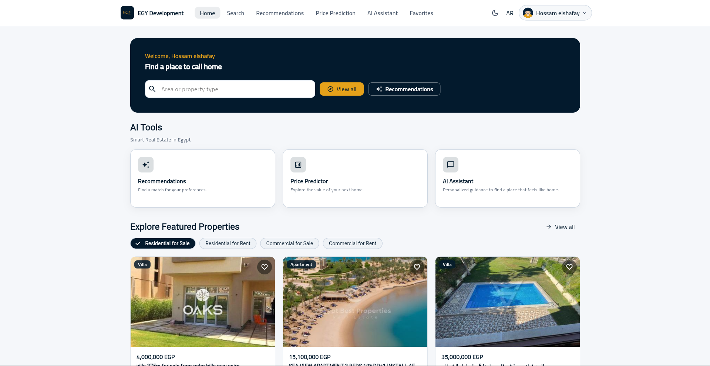
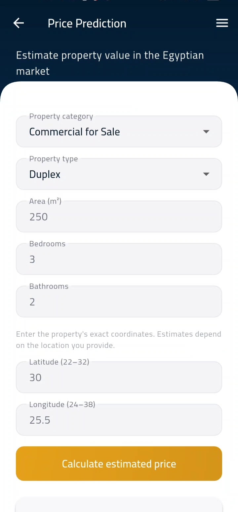
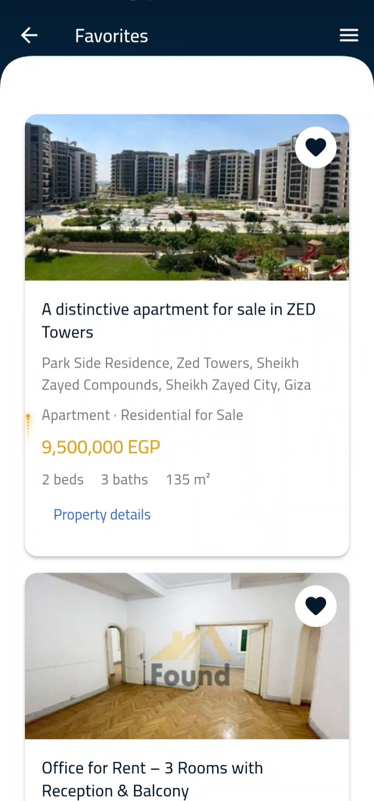
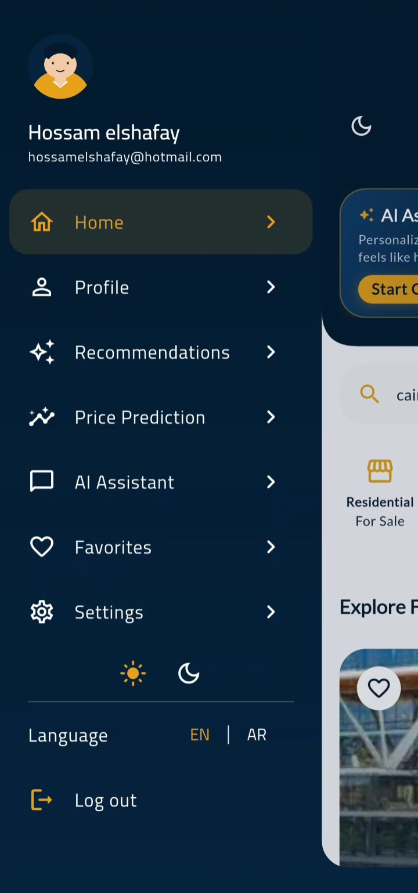
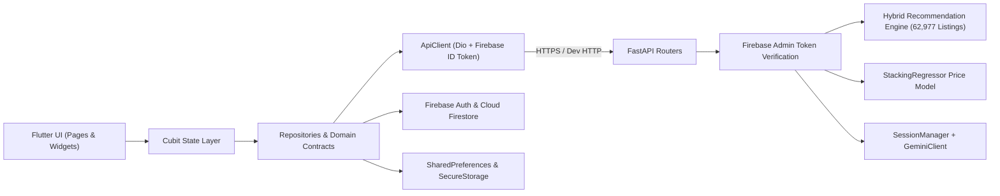

# EGY DEVELOPMENT

**Full-Stack AI-Driven Egyptian Real Estate Discovery, Valuation, and Advisory Platform**

EGY DEVELOPMENT is an independent, full-stack real estate platform engineered with **Flutter** (Android, dedicated responsive Web, and iOS-ready Mobile), **Firebase** (Authentication and Cloud Firestore), and a **FastAPI** AI/ML backend. The system unifies categorized property discovery, hybrid machine-learning recommendations over 62,977 cleaned listings, ensemble price valuation, and a session-aware conversational AI assistant inside a bilingual (English LTR / Arabic RTL) interface with Light and Dark themes.

---

## Core Capabilities

- **Intelligent Property Discovery**: Categorized residential and commercial catalog (Sale and Rent), stacked featured-property carousel, debounced live search suggestions, and hero-transitioned property detail views.
- **Hybrid AI Recommendations**: Vectorized multi-criteria filtering paired with a cascade hybrid engine combining K-Means clustering and content-based cosine similarity for similar-property matching.
- **ML Price Prediction**: Real-time property valuation in EGP using a trained `StackingRegressor` ensemble (`scikit-learn` + `XGBoost`), returning rounded price estimates, per-meter rates, and a ±8% heuristic range.
- **Conversational AI Assistant**: Authenticated Gemini-powered property advisor (`GeminiClient`) with UID-bound server-side TTL session management and encrypted client-side chat persistence.
- **Firebase Identity & Cloud Sync**: Email/Password and Google Sign-In authentication, two-step sign-up with avatar selection, UID-scoped Cloud Firestore profiles and favorites, and automatic email-verification refresh on app resume.
- **Shared Multi-Platform Client**: Single Flutter codebase powering Android, a dedicated responsive Flutter Web desktop experience (separate `lib/core/web/` and `lib/features/*/web/` UI layers), and an iOS-ready Mobile configuration while sharing Cubits, repositories, Firebase, and FastAPI contracts.

---

## Complete Technology Stack

### Frontend & Application Engineering

| Technology | Role in System |
|---|---|
| **Flutter & Dart (`^3.12.2`)** | Cross-platform UI runtime powering Android and Web from one codebase. |
| **`flutter_bloc` (`Cubit`) & `equatable`** | Predictable state management for authentication, session lifecycle, catalog, recommendations, prediction, chat, favorites, profile, and theme/locale. |
| **`go_router`** | Declarative routing with `ShellRoute` drawer integration, auth-aware `redirect` guards, and custom `CustomTransitionPage` animations. |
| **`get_it`** | Manual service-locator dependency injection (`sl`) registering external SDKs, datasources, repositories, and screen-scoped Cubit factories. |
| **`dio`** | HTTP client encapsulated inside `ApiClient` with per-request Firebase ID-token injection, strict URI/scheme validation, and endpoint-specific timeouts. |
| **`CustomPainter` & `lottie`** | Native canvas rendering for the Cairo skyline splash, curved headers/dividers, orbiting card borders, vector avatars, and Lottie auth-result playback. |
| **`flutter_localizations` & `intl`** | Compile-time ARB localization (`app_en.arb`, `app_ar.arb`) with full LTR/RTL layout mirroring and locale-aware number formatting. |
| **`google_fonts` & `material_ui`** | Consistent typography (`AppTextStyles`) and Material 3 Light/Dark theme tokens (`AppColors`, `AppTheme`). |
| **`shared_preferences`** | Device-local persistence for onboarding state, Light/Dark appearance preference, and UID-scoped avatar fallback. |
| **`flutter_secure_storage`** | Encrypted local storage for UID-scoped AI chat history (`chat_v1_<base64Url(uid)>`). |

### Firebase & Cloud Services

| Technology | Role in System |
|---|---|
| **Firebase Core & Auth** | Client SDK managing Email/Password registration, sign-in, password resets, `verifyBeforeUpdateEmail`, `reload()`, and ID-token issuance. |
| **Google Sign-In (`google_sign_in`)** | Federated Google authentication and reauthentication for sensitive account operations. |
| **Cloud Firestore** | UID-scoped cloud persistence for `/users/{uid}` profile mirrors (`name`, `avatarId`, `updatedAt`, `schemaVersion`) and `/users/{uid}/favorites/{favoriteId}`. |
| **Firebase Admin SDK** | Server-side fail-closed token verification (`verify_id_token(..., check_revoked=True)`) in FastAPI. |

### Backend & API

| Technology | Role in System |
|---|---|
| **Python 3.13 & FastAPI** | Asynchronous REST API server exposing health, prediction, recommendation, catalog, and chat endpoints. |
| **Uvicorn** | ASGI server running FastAPI with `anyio.to_thread.run_sync` offloading CPU-bound ML inference and blocking LLM calls off the event loop. |
| **Pydantic & `pydantic-settings`** | Strict request/response schema validation and centralized `.env` configuration loading (`core/config.py`). |
| **Starlette `CORSMiddleware`** | Origin-restricted CORS policy (`http://localhost:3000`, `http://127.0.0.1:3000`) supporting `GET`, `POST`, `OPTIONS` and `Authorization`, `Content-Type` headers. |

### Machine Learning & Data Processing

| Technology | Role in System |
|---|---|
| **scikit-learn (`1.9.1`) & XGBoost** | Powers the serialized `StackingRegressor` price prediction model and cosine similarity scoring. |
| **Pandas, NumPy, SciPy & PyArrow** | Loads `cleaned_properties.parquet` (62,977 listings) and sparse `feature_matrix.npz` for sub-millisecond vectorized filtering and ranking. |
| **Joblib** | Deserializes `final_price_prediction_model.joblib` and recommendation ID-index mappings (`id_to_idx.joblib`, `idx_to_id.joblib`). |

### Generative AI

| Technology | Role in System |
|---|---|
| **Google GenAI SDK (`google-genai`)** | Powers `GeminiClient` (`gemini-3.5-flash-lite`) for conversational real estate guidance and property suggestions. |
| **`SessionManager`** | Thread-safe, in-memory, UID-owned session store with configurable TTL eviction (`SESSION_TTL_SECONDS=1800`). |

### Development & Quality

- **Testing**: `flutter_test` (unit, widget, transition, theme, and skeleton tests) and Python `unittest` + FastAPI `TestClient` integration tests.
- **Static Analysis & Hygiene**: `flutter analyze`, `flutter_lints`, `git diff --check`, and pre-commit secret scanning.

---

## Application Showcase — Videos

### 1. Splash Screen
Custom-painted Cairo skyline construction, Nile and sun motion, and smooth transition into onboarding.

https://github.com/user-attachments/assets/99311669-1872-43a2-ba84-9e1112386796

### 2. Onboarding
Gesture-driven vertical `PageView` transitions with continuous `PageController.page` interpolation and language selection.

https://github.com/user-attachments/assets/86ea76d0-bcda-4989-bf03-e47a73f2d86e

### 3. Authentication
Asymmetric curved header morphing, two-step registration with avatar selection, and Lottie completion transition into Home.

https://github.com/user-attachments/assets/4b613bc9-570f-421a-998b-5a549f7d350e

### 4. Home & Property Animations
Convex navy header, category flip transitions, stacked featured property carousel, and AI tool shortcuts.

https://github.com/user-attachments/assets/3b60ab54-ffe5-49e9-8efc-5d3a01c7870c

### 5. Search Experience
Expanding search overlay with debounced backend queries, skeleton placeholders, and direct navigation to property details.

https://github.com/user-attachments/assets/22cd26de-ed59-49be-8ea6-ca1142901302

### 6. AI Chatbot
Conversational property assistant with session management, typing indicators, and inline property recommendations.

https://github.com/user-attachments/assets/b53e056c-eb8c-414d-aa60-4ad8cfb7cd50

---

## Flutter Web Experience

Unlike a stretched mobile layout, Flutter Web uses a dedicated responsive presentation layer (`lib/core/web/` and `lib/features/*/web/`) while reusing the same Cubits, repositories, Firebase Auth/Firestore integration, and FastAPI AI backend.

<p align="center">
  
</p>

- **Desktop Navigation (`WebAppShell`)**: Clean horizontal top navigation bar (`Home`, `Search`, `Recommendations`, `Price Prediction`, `AI Assistant`, `Favorites`), Light/Dark theme toggle, EN/AR language switcher, account menu, and a responsive drawer fallback on narrow viewports.
- **Responsive Home & Property Discovery**: Hero search banner (`HomeSearchCubit`), 3-column AI Tools cards, category-filtered featured property grids (`WebHomePage`, `WebCatalogPage`), and a two-column property details gallery (`WebPropertyDetailsPage`).
- **50/50 Split-Screen Authentication (`WebSplitAuthLayout`, `WebAuthPage`)**: Skips Mobile Splash/Onboarding on Web and presents a navy brand panel paired with Login, 2-step Sign Up (with 6-avatar selection), Forgot Password, and Google Sign-In.
- **Web AI Tools & Safe Markdown Chat**: Dedicated `WebRecommendationsPage` (sidebar filters + grid), `WebPredictionPage` (two-column specs & valuation), and `WebChatPage` with `WebMarkdownText` (bold, italic, lists, safe `http`/`https` links, automatic Arabic RTL/English LTR per paragraph, and horizontal recommendation cards).
- **Web Theme & Performance**: Dedicated `WebPalette` / `WebTheme` Light and Dark tokens (`#0D1722` background, `#172737` cards, `#243648` inputs, `#EAA81C` gold accent in Dark Mode) with instant Web theme switching (bypassing Mobile's `RenderRepaintBoundary` circular capture on Web).

---

## Feature Gallery — Mobile Screenshots

<table>
  <tr>
    <td align="center" width="50%">
      <br />
      <sub><strong>1. AI Recommendations</strong> — Hybrid matches and similar listings.</sub>
    </td>
    <td align="center" width="50%">
      <br />
      <sub><strong>2. Price Prediction</strong> — EGP valuation and per-meter rate.</sub>
    </td>
  </tr>
  <tr>
    <td align="center" width="50%">
      <br />
      <sub><strong>3. Favorites</strong> — UID-scoped saved properties in Firestore.</sub>
    </td>
    <td align="center" width="50%">
      <br />
      <sub><strong>4. Navigation Drawer</strong> — Theme, language, and feature routes.</sub>
    </td>
  </tr>
  <tr>
    <td align="center" width="50%">
      <br />
      <sub><strong>5. Profile</strong> — Verified identity, display name, and avatar.</sub>
    </td>
    <td align="center" width="50%">
      <br />
      <sub><strong>6. Settings</strong> — Account security, theme, and language.</sub>
    </td>
  </tr>
</table>

---

## System Architecture



### Flutter Application Architecture

- **Feature-First Modularity**: Each capability (`splash`, `onboarding`, `authentication`, `home`, `properties`, `recommendations`, `price_prediction`, `ai_chat`, `favorites`, `profile`) encapsulates its own `data/`, `domain/`, and `presentation/` (`pages/`, `widgets/`, `cubit/`) layers.
- **State & Error Separation**: Datasources return raw models or throw platform/transport exceptions; repositories map exceptions via `guardApi` / `_guard` into typed `Failure` subclasses (`NetworkFailure`, `UnauthenticatedFailure`, `ServerFailure`, `AuthFailure`, `CacheFailure`) consumed by Cubits.
- **Navigation & Shell Lifecycle**: `go_router` wraps authenticated destinations in a `ShellRoute` (`DrawerScaffold` + `RevealNavigation`), while `SessionPage` shares a single persistent navy header across Login, Register, Reset Password, and Home. `App` observes `AppLifecycleState.resumed` to refresh Firebase Auth state without forcing re-login.

### Backend Architecture

- **Lifespan & Lazy Loading**: `app.py` loads `final_price_prediction_model.joblib` and initializes `GeminiClient` + `SessionManager` during FastAPI startup, while `HybridRecommendationEngine` lazy-loads the 62,977-row Parquet catalog and sparse matrices on first recommendation/catalog request.
- **Thread-Pool Offloading**: Blocking ML inference (`predict_price`) and synchronous LLM turns (`sessions.send`) execute via `anyio.to_thread.run_sync` to keep the ASGI event loop responsive.
- **Fail-Closed Auth**: All `/api/predict`, `/api/recommendations`, and `/api/chat` routers attach `Depends(require_user)`.

### End-to-End Request & Persistence Flows

1. **AI/Backend Flow**: Flutter retrieves a fresh Firebase ID token via `currentUser?.getIdToken()`, `ApiClient` validates `API_BASE_URL` and attaches `Authorization: Bearer <token>`, FastAPI verifies signature/revocation via Firebase Admin, executes ML/LLM inference, and returns validated JSON mapped back into Cubit states (`Loading` → `Ready` / `Error`).
2. **Firestore Sync Flow**: Profile updates (`name`, `avatarId`) write to `/users/{uid}` in Cloud Firestore first, then update Firebase Auth (`updateDisplayName`, `updatePhotoURL`) and local `AvatarPreferences` — preventing partial Auth-only updates from masking cloud sync failures. Favorites sync directly with `/users/{uid}/favorites/{favoriteId}`.

---

## AI/ML Engineering

### AI Recommendations (`core/recommendation_engine.py`)

- **Dataset & Artifacts**: 62,977 cleaned listings (`cleaned_properties.parquet`), sparse feature matrix (`feature_matrix.npz`), clustering artifacts (`models/clustering/`), and precomputed similarity neighbors (`top_indices.npy`, `top_scores.npy`) with bidirectional ID mappings.
- **Filtering & Ranking**: Multi-criteria vectorized filtering across category, property type, city, price/size ranges, bedrooms, bathrooms, and amenities, paired with similarity ranking, offset/limit pagination, and `similar`-listing lookup.
- **Home Catalog Sampling**: `CatalogSampler` serves deduplicated category samples (`POST /api/recommendations/catalog/sample`) while excluding previously seen IDs.

### Price Prediction (`core/price_prediction.py`, `api/predict.py`)

- **Model**: Serialized `StackingRegressor` (`final_price_prediction_model.joblib`, trained with `scikit-learn==1.9.1` and `xgboost`).
- **Features & Vocabulary**: Uses 7 explicit inputs (`size`, `bedrooms`, `bathrooms`, `latitude`, `longitude`, `property_type`, `category`); valid vocabularies are exposed dynamically via `GET /api/predict/options` (`model_contract`) so client dropdowns always match the trained model.
- **Output & Resolution**: Rounds predictions to `25,000 EGP` for sales (`500 EGP/month` for rentals), computes `meter_price`, and returns a `±8%` heuristic range (`heuristic_plus_minus_8_percent_rounded`).

### AI Chatbot (`api/chat.py`, `core/sessions.py`, `src/chatbot/chat_engine.py`)

- **LLM Integration**: Uses `GeminiClient` (`gemini-3.5-flash-lite`) gated by both server (`CHAT_ENABLED=true`) and client (`--dart-define=ENABLE_LIVE_CHAT=true`) flags.
- **Session & Persistence Model**: Server sessions live in memory inside `SessionManager` (30-minute TTL, UID-verified ownership, per-session lock). Client-side conversation history is persisted locally on the device in encrypted storage via `SecureChatHistoryRepository`.

---

## Flutter Engineering & UI Architecture

- **Animated Brand Intro & Onboarding**: `CairoSkylinePainter` renders the custom-painted multi-stage splash sequence; `OnboardingPage` drives continuous `PageController.page` interpolation across vertical slides.
- **Two-Step Sign Up & Shell Morphing**: Registration collects validated account credentials on Step 1 and transitions with an RTL-aware slide to `SignupAvatarStep` (Step 2 of 2) with a live gold-ringed preview and 6-avatar grid before creating the Firebase account. `SessionPage` + `AsymmetricAuthClipper` morph the header continuously into Home after Lottie completion.
- **Home Discovery & Motion**: `HomeFeaturedCarousel` renders stacked cards with `HomeCategoryFlip` transitions; `HomeSearchRoute` opens an expanding search overlay with debounced queries; `PropertyHero` bridges cards into `PropertyDetailsPage` with a curved `PropertyImageClipper`.
- **Circular Theme Reveal & Skeletons**: `ThemeReveal` captures the outgoing render layer into an in-memory image and animates a circular clip from the tapped toggle's global center (Light ↔ Dark). `SkeletonShimmer` (`app_skeleton.dart`) provides theme-aware placeholders across Home, Recommendations, Favorites, Search, Catalog, Details, Profile, and Price Prediction while automatically pausing when off-screen or when reduced motion is enabled.
- **Bilingual RTL/LTR**: All copy lives in `app_en.arb` and `app_ar.arb` using directional layout primitives (`EdgeInsetsDirectional`, `PositionedDirectional`).

---

## Authentication, Cloud Persistence & Security

- **Authentication**: Email/Password and Google Sign-In (`AuthRemoteDatasource`), including reauthentication before email/password changes or verified account deletion (`AccountCleanup` deletes Firestore favorites/profile and local storage before removing the Firebase user).
- **Email Change Refresh**: `verifyBeforeUpdateEmail` keeps the current email active until verified; `App` (`WidgetsBindingObserver`) triggers `SessionCubit.refresh()` on `AppLifecycleState.resumed`, calling `currentUser.reload()` and syncing open Profile/Settings screens without requiring logout.
- **Firestore Rules (`firestore.rules`)**: Strict UID-scoped rules (`request.auth != null && request.auth.uid == uid`) validate schema fields, types, string lengths, avatar IDs, and server timestamps on `/users/{uid}` and `/users/{uid}/favorites/{favoriteId}`, with deny-all fallback.
- **Transport & Secret Hygiene**: `ApiClient` blocks empty/malformed URLs, query/fragment injection, redirects (`followRedirects: false`), and loopback addresses in Release builds (`kReleaseMode` enforces `https://`). Private secrets (`EGY_DEVELOPMENT_ai/.env`, Firebase Admin service-account JSON) remain local and gitignored; `google-services.json` and `firebase_options.dart` contain only public Firebase client identifiers.

---

## Backend API

| Endpoint | Auth | Purpose |
|---|---|---|
| `GET /api/health` | Public | Reports `status`, `model_loaded`, `llm_client_ready`, `active_sessions`, and `llm_backend`. |
| `GET /api/predict/options` | Firebase ID Token | Returns valid `categories` and `property_types` from the loaded regression model. |
| `POST /api/predict` | Firebase ID Token | Predicts property price, per-meter price, and ±8% heuristic range. |
| `POST /api/recommendations/catalog/sample` | Firebase ID Token | Returns bounded, deduplicated category samples for Home and Catalog. |
| `POST /api/recommendations/search` | Firebase ID Token | Multi-criteria filtered search and pagination across 62,977 listings. |
| `GET /api/recommendations/{id}` | Firebase ID Token | Retrieves full details for a single property ID. |
| `GET /api/recommendations/similar` | Firebase ID Token | Returns hybrid cluster + cosine-similarity matches for a property. |
| `POST /api/chat` | Firebase ID Token | Sends a chat turn within a UID-owned session (returns `503` when chat is disabled). |

---

## Installation & Configuration

### Prerequisites

- Flutter SDK (Dart SDK `^3.12.2`)
- Python 3.13+
- Firebase project (`real-estate-e1418`) with a local Firebase Admin service-account JSON stored outside the repository (e.g., `%USERPROFILE%\firebase-secrets\egy-firebase-admin.json`)

### 1. Backend Setup

```powershell
cd EGY_DEVELOPMENT_ai
python -m venv .venv
.venv\Scripts\pip install -r requirements.txt
copy .env.example .env
```

Set `GEMINI_API_KEY` in `EGY_DEVELOPMENT_ai/.env` and ensure `GOOGLE_APPLICATION_CREDENTIALS` points to your local service-account JSON. Start the server from the repository root:

```powershell
.\START_BACKEND.bat
```

### 2. Flutter Setup

```powershell
flutter pub get
flutter gen-l10n
```

---

## Running Android & Flutter Web

### Android over USB (ADB Reverse)

```powershell
adb reverse tcp:8000 tcp:8000
flutter run --dart-define=API_BASE_URL=http://127.0.0.1:8000 --dart-define=ENABLE_LIVE_CHAT=true
```

### Android Profile Mode over Wi-Fi

```powershell
flutter run --profile `
  --dart-define=API_BASE_URL=http://<LAPTOP_LAN_IP>:8000 `
  --dart-define=ENABLE_LIVE_CHAT=true `
  --dart-define=API_DEBUG_LOGS=true
```

### Flutter Web (Chrome)

```powershell
flutter run -d chrome `
  --web-port=3000 `
  --dart-define=API_BASE_URL=http://127.0.0.1:8000 `
  --dart-define=ENABLE_LIVE_CHAT=true `
  --dart-define=API_DEBUG_LOGS=true
```

---

## iOS Readiness & Mac Setup

The repository is prepared on the configuration, branding, and networking layers for a macOS developer to clone, configure signing, and run on an iOS Simulator or physical iPhone. **Note:** Native iOS compilation (`pod install`, `xcodebuild`) has not yet been executed on macOS.

- **iOS Project & Branding**: Deployment target updated to iOS `15.0` in `ios/Runner.xcodeproj/project.pbxproj` and `ios/Podfile`, `Info.plist` display name set to `EGY Development` with scoped `NSAllowsLocalNetworking = true`, and all 15 opaque `AppIcon.appiconset` icons generated from `assets/img/logo.png`.
- **Firebase & Networking**: `DefaultFirebaseOptions.ios` (`real-estate-e1418`, `com.example.egy`) is configured in `lib/firebase_options.dart`, and `ApiClient.allowsLocalLoopback` supports `127.0.0.1` / `localhost` on `TargetPlatform.iOS` in Debug/Profile builds.
- **Mac Developer Requirements**: Requires macOS, Xcode, CocoaPods, adding `ios/Runner/GoogleService-Info.plist` (+ `REVERSED_CLIENT_ID` URL scheme for Google Sign-In), and selecting an Apple Signing Team in `ios/Runner.xcworkspace`.

See the step-by-step guide in [docs/IOS_SETUP.md](docs/IOS_SETUP.md) and the macOS bootstrap script at [scripts/setup_ios.sh](scripts/setup_ios.sh):

```bash
chmod +x scripts/setup_ios.sh
./scripts/setup_ios.sh
```

---

## Testing & Quality Assurance

### Flutter Analysis & Tests

```powershell
flutter analyze --no-pub
flutter test --no-pub --concurrency=1
```

### Python Backend Tests

```powershell
cd EGY_DEVELOPMENT_ai
.venv\Scripts\python.exe -m unittest discover -s tests -v
```

---

## Project Structure

```text
egy/
├── android/                  # Android manifests, Gradle config, and EGY launcher icons
├── assets/                   # Brand images (logo, home-web.png), Lottie animations, README media
├── docs/                     # Technical docs (API contracts, architecture, theme, IOS_SETUP.md)
├── EGY_DEVELOPMENT_ai/       # FastAPI backend, ML/recommendation artifacts, and tests
│   ├── api/                  # chat.py, predict.py, recommendations.py
│   ├── core/                 # auth.py, config.py, price_prediction.py, recommendation_engine.py, sessions.py
│   ├── data/                 # Property datasets
│   ├── models/               # Saved regression, clustering, and CBF artifacts
│   ├── src/chatbot/          # GeminiClient and conversation engine
│   └── tests/                # Backend unittest suite
├── ios/                      # iOS Runner, Podfile (iOS 15.0), Info.plist, and EGY AppIcons
├── lib/
│   ├── app/                  # App shell, DI (get_it), ARB l10n, platform-aware go_router, AppTheme
│   ├── core/                 # ApiClient, failures, shared mobile widgets, and core/web/ design system
│   └── features/             # Feature-First MVVM modules (10 features, Mobile presentation/ + web/)
├── scripts/                  # Local backend supervisor, smoke checks, and setup_ios.sh
├── test/                     # Flutter unit, widget, theme, Web responsive, and transition tests
├── web/                      # Flutter Web entrypoint, manifest.json, and EGY favicon/icons
├── firestore.rules           # UID-scoped Cloud Firestore security rules
└── pubspec.yaml              # Flutter dependencies and asset declarations
```

---

## Known Limitations

- **GitHub Video Layout**: GitHub Markdown does not support side-by-side layout inside HTML tables for auto-expanded `user-attachments` video embeds without breaking CommonMark HTML blocks, so the six MP4 demos render sequentially as native inline players.
- **In-Memory Server Chat Sessions**: `SessionManager` holds active LLM sessions in single-process memory with a 30-minute TTL; server restarts clear active server-side LLM context, while local chat transcripts remain stored on the client device.
- **Local HTTP Development**: Development builds target local HTTP (`127.0.0.1` or LAN IP); production deployments require an HTTPS reverse proxy and setting `API_BASE_URL` to an `https://` URL.
- **Firestore Rules Deployment**: Updated `/users/{uid}` rules in `firestore.rules` must be deployed (`firebase deploy --only firestore:rules`) for live cloud profile sync.
- **iOS Build Pending macOS**: iOS project settings, Podfile, AppIcons, and setup documentation were prepared on Windows; `pod install`, `GoogleService-Info.plist` placement, Xcode signing, and Simulator/iPhone verification must be run on macOS.
