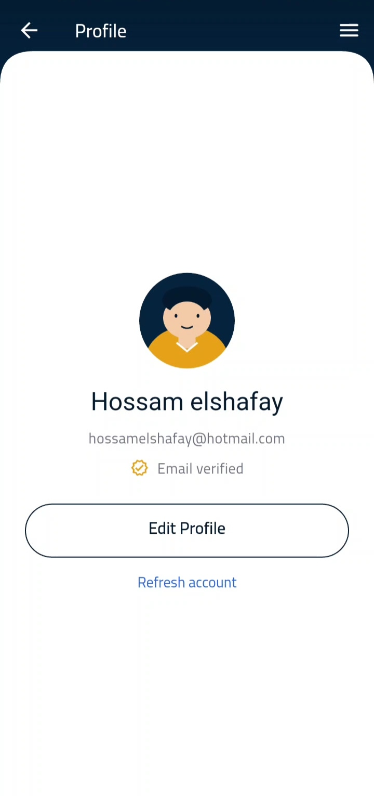

# EGY DEVELOPMENT

**Intelligent Egyptian Real Estate Discovery, Valuation, and Advisory Platform**

EGY DEVELOPMENT is a full-stack real estate application built with Flutter (Android and Web), Firebase (Authentication and Cloud Firestore), and a FastAPI AI backend. It combines property discovery, hybrid content/cluster recommendations, machine-learning price prediction, and a conversational AI assistant in a bilingual (English/Arabic) interface with Light and Dark themes.

---

## Project Overview

Navigating the Egyptian real estate market requires comparing fragmented listings, estimating fair market value across diverse neighborhoods, and filtering properties by practical constraints. EGY DEVELOPMENT unifies these workflows into a single client-server platform:

- **Mobile & Web Client**: Flutter application structured around Feature-First MVVM, `Cubit` state management, `go_router`, and manual `get_it` dependency injection.
- **Identity & Cloud Persistence**: Firebase Authentication (Email/Password and Google Sign-In) with Cloud Firestore for UID-scoped user profiles and saved favorites, plus `flutter_secure_storage` for local chat history.
- **AI & Analytics Backend**: FastAPI service exposing authenticated endpoints backed by a `StackingRegressor` price prediction model, hybrid recommendation artifacts over 62,977 cleaned listings, and a Gemini-powered conversational assistant.

---

## Key Features

- **Bilingual & Theme-Aware UI**: Full English (LTR) and Arabic (RTL) localization (`flutter_localizations`, ARB files) with Light, Dark, and System appearance modes and a circular-reveal theme transition.
- **Animated Brand Experience**: Custom-painted Cairo skyline splash animation, gesture-driven vertical onboarding transitions, asymmetric auth-to-home shell morphing, and skeleton loading states across asynchronous screens.
- **Property Discovery & Search**: Categorized property catalog (Residential/Commercial for Sale/Rent), featured stacked-card carousel, interactive search with live backend suggestions, and curved-hero property details.
- **AI Recommendations**: Filtered property search, pagination, and similar-property discovery powered by content-based and clustering artifacts.
- **Price Prediction**: Real-time property valuation using area, bedrooms, bathrooms, coordinates, category, and property type, returning an estimated price, per-meter rate, and heuristic range.
- **AI Chat Assistant**: Session-managed conversational property advisor with typing indicators, suggested follow-ups, and encrypted local chat persistence.
- **Account & Profile Management**: Two-step sign-up with avatar selection, profile editing (Display Name + 6 vector avatars) synced to Firebase Auth and Cloud Firestore, email verification/change flows, password updates, and verified account deletion.

---

## Technology Stack

| Layer | Technologies |
|---|---|
| **Frontend** | Flutter, Dart, `flutter_bloc` (`Cubit`), `go_router`, `get_it`, `dio`, `google_fonts`, `lottie`, `shared_preferences`, `flutter_secure_storage` |
| **Cloud & Auth** | Firebase Core, Firebase Authentication, Google Sign-In, Cloud Firestore, Firebase Admin SDK |
| **Backend API** | Python 3.13, FastAPI, Uvicorn, Pydantic Settings |
| **Machine Learning** | scikit-learn (`StackingRegressor`), XGBoost, SciPy, NumPy, Pandas, PyArrow, Joblib |
| **LLM Integration** | Google GenAI (`GeminiClient` / `gemini-3.5-flash-lite`) |

---

## Application Demo

### Animated Application Showcase

Original high-resolution recordings demonstrating the core user journeys:

#### 1. Splash Screen
Custom-painted Cairo skyline construction, Nile and sun motion, and smooth transition into onboarding.

https://github.com/user-attachments/assets/42066020-c999-41cf-a7e1-cbec1f9f5d11

#### 2. Onboarding
Gesture-driven vertical `PageView` transitions with continuous `PageController.page` interpolation and language selection.

https://github.com/user-attachments/assets/cc41fb6b-f6f0-421b-8f74-2f74fe0f7736

#### 3. Authentication
Asymmetric curved header morphing, two-step registration with avatar selection, and Lottie completion transition into Home.

https://github.com/user-attachments/assets/6cb56687-8f77-486f-8a20-e77768a915fd

#### 4. Home & Property Animations
Convex navy header, category flip transitions, stacked featured property carousel, and AI tool shortcuts.

https://github.com/user-attachments/assets/fda9dde7-d64a-4820-8ae6-d653c09ac100

#### 5. Search Experience
Expanding search overlay with debounced backend queries, skeleton placeholders, and direct navigation to property details.

https://github.com/user-attachments/assets/f0cb3b82-e9b2-45ef-a6d4-1ab5b0cb1215

#### 6. AI Chatbot
Conversational property assistant with session management, typing indicators, and inline property recommendations.

https://github.com/user-attachments/assets/f6c6b960-f557-4ba2-87f3-b47305105d2e

### Static Screenshot Gallery

<table>
  <tr>
    <td align="center" width="50%">
      <br />
      <sub><strong>1. AI Recommendations</strong> — Filtered hybrid matches and similar-listing discovery.</sub>
    </td>
    <td align="center" width="50%">
      <br />
      <sub><strong>2. Price Prediction</strong> — Market value estimation with per-meter rate and range.</sub>
    </td>
  </tr>
  <tr>
    <td align="center" width="50%">
      <br />
      <sub><strong>3. Favorites</strong> — UID-scoped saved properties synced with Cloud Firestore.</sub>
    </td>
    <td align="center" width="50%">
      <br />
      <sub><strong>4. Navigation Drawer</strong> — Reveal menu with theme, language, and feature routes.</sub>
    </td>
  </tr>
  <tr>
    <td align="center" width="50%">
      <br />
      <sub><strong>5. Profile</strong> — Verified account identity, display name, and selected avatar.</sub>
    </td>
    <td align="center" width="50%">
      <br />
      <sub><strong>6. Settings</strong> — Account editing, security actions, theme, and language controls.</sub>
    </td>
  </tr>
</table>

---

## AI-Powered Features

- **Hybrid Recommendations (`POST /api/recommendations/search`, `POST /api/recommendations/catalog/sample`, `GET /api/recommendations/{id}`)**: Combines content-based feature matrices and clustering artifacts (`cleaned_properties.parquet`, `feature_matrix.npz`, `top_indices.npy`, `top_scores.npy`) to surface matching properties and paginated results.
- **Price Prediction (`POST /api/predict`, `GET /api/predict/options`)**: Uses a trained `StackingRegressor` (`final_price_prediction_model.joblib`) on 7 property features (`size`, `bedrooms`, `bathrooms`, `latitude`, `longitude`, `property_type`, `category`) to output estimated EGP value and a ±8% heuristic range.
- **AI Chat (`POST /api/chat`)**: Connects to Gemini (`GeminiClient`) when `CHAT_ENABLED=true` on the backend and `--dart-define=ENABLE_LIVE_CHAT=true` on the client, with server-side session TTL eviction and encrypted local history on device.

---

## Architecture

EGY DEVELOPMENT follows a **Feature-First MVVM + Cubit + Repository** architecture inspired by [hossamelshafay/ConnectHub](https://github.com/hossamelshafay/ConnectHub):

- **Feature Modules (`lib/features/<feature>/`)**: Each feature is organized into `data/` (remote/local datasources, DTOs, repository implementations), `domain/` (entities, repository contracts), and `presentation/` (`pages/`, `widgets/`, `cubit/`).
- **Shared Core (`lib/core/`)**: Reusable `ApiClient` (Firebase ID-token injection and environment validation), `AuthenticatedScaffold`, curved header clippers/dividers, skeleton loaders, and error/failure types.
- **App Shell (`lib/app/`)**: Centralized `go_router` configuration, manual `get_it` service locator (`injection.dart`), `AppTheme` / `AppColors`, `ThemeCubit` / `ThemeReveal`, and `LocaleCubit`.

---

## Firebase & Backend Integration

- **Authentication**: Every protected FastAPI endpoint requires a valid Firebase ID token (`Authorization: Bearer <token>`), verified server-side via Firebase Admin SDK (`GOOGLE_APPLICATION_CREDENTIALS`).
- **Firestore Security (`firestore.rules`)**: Strict UID-scoped rules (`request.auth != null && request.auth.uid == uid`) for `/users/{uid}` profiles and `/users/{uid}/favorites/{favoriteId}` documents, with deny-all fallback.
- **Network Security**:
  - `ApiClient` requires explicit `--dart-define=API_BASE_URL=...` configuration.
  - Debug/Profile builds allow Android ADB reverse (`http://127.0.0.1:<port>`), LAN HTTP (`http://<lan-ip>:8000` with `android:usesCleartextTraffic="true"` in Debug/Profile manifests), and Web local loopback (`http://localhost:<port>` / `http://127.0.0.1:<port>`).
  - Release builds enforce `https://` and block loopback addresses; `android/app/src/main/AndroidManifest.xml` keeps `android:usesCleartextTraffic="false"`.
- **FastAPI CORS**: Restricted to `http://localhost:3000` and `http://127.0.0.1:3000` with `GET`, `POST`, `OPTIONS` and `Authorization`, `Content-Type` headers.

---

## Installation & Setup

### Prerequisites

- Flutter SDK (Dart SDK `^3.12.2`)
- Python 3.13+ with virtual environment in `EGY_DEVELOPMENT_ai/.venv`
- Firebase project (`real-estate-e1418`) and local Firebase Admin service-account JSON (kept outside the repository, e.g., `%USERPROFILE%\firebase-secrets\egy-firebase-admin.json`)

### 1. Backend Setup

```powershell
cd EGY_DEVELOPMENT_ai
python -m venv .venv
.venv\Scripts\pip install -r requirements.txt
copy .env.example .env
```

Edit `EGY_DEVELOPMENT_ai/.env` locally with your `GEMINI_API_KEY` and set `GOOGLE_APPLICATION_CREDENTIALS` to your local service-account JSON path. Start the backend from the repository root:

```powershell
.\START_BACKEND.bat
```

Verify health: `http://127.0.0.1:8000/api/health`

### 2. Flutter Setup

```powershell
flutter pub get
flutter gen-l10n
```

---

## Running Android

### Over USB (ADB Reverse)

```powershell
adb reverse tcp:8000 tcp:8000
flutter run --dart-define=API_BASE_URL=http://127.0.0.1:8000 --dart-define=ENABLE_LIVE_CHAT=true
```

### Over Wi-Fi (Debug or Profile)

Replace `<LAPTOP_LAN_IP>` with your machine's Wi-Fi IPv4 address (e.g., `192.168.1.8`):

```powershell
flutter run --profile `
  --dart-define=API_BASE_URL=http://<LAPTOP_LAN_IP>:8000 `
  --dart-define=ENABLE_LIVE_CHAT=true `
  --dart-define=API_DEBUG_LOGS=true
```

---

## Running Flutter Web

Start the backend, then launch Chrome on port `3000`:

```powershell
flutter run -d chrome `
  --web-port=3000 `
  --dart-define=API_BASE_URL=http://127.0.0.1:8000 `
  --dart-define=ENABLE_LIVE_CHAT=true `
  --dart-define=API_DEBUG_LOGS=true
```

---

## Testing

### Flutter Analysis & Tests

```powershell
flutter analyze --no-pub
flutter test --no-pub --concurrency=1
```

### Backend Tests

```powershell
cd EGY_DEVELOPMENT_ai
.venv\Scripts\python.exe -m unittest discover -s tests -v
```

---

## Repository Structure

```text
egy/
├── android/                  # Android platform config & manifests (debug/profile/main)
├── assets/                   # Images, Lottie animations, and README media
│   ├── img/
│   ├── lottie/
│   └── readme/
│       ├── gif/              # 6 MP4 showcase recordings
│       └── screens/          # Static feature screenshots
├── docs/                     # Architecture, API contracts, theme, and startup docs
├── EGY_DEVELOPMENT_ai/       # FastAPI backend, ML artifacts, and Python tests
│   ├── api/                  # Chat, prediction, and recommendations routers
│   ├── core/                 # Config, auth verification, sessions, startup
│   ├── data/                 # Property datasets
│   ├── models/               # Saved regression & recommendation artifacts
│   └── tests/                # Backend unittest suite
├── lib/
│   ├── app/                  # App shell, DI (get_it), l10n (ARB), go_router, theme
│   ├── core/                 # Network (ApiClient), errors, shared widgets & skeletons
│   └── features/             # Feature-First MVVM modules
│       ├── ai_chat/
│       ├── authentication/
│       ├── favorites/
│       ├── home/
│       ├── onboarding/
│       ├── price_prediction/
│       ├── profile/
│       ├── properties/
│       ├── recommendations/
│       └── splash/
├── scripts/                  # Local backend launcher & smoke verification helpers
├── test/                     # Flutter unit, widget, and transition tests
├── web/                      # Flutter Web entrypoint
├── firestore.rules           # UID-scoped Cloud Firestore security rules
└── pubspec.yaml              # Flutter dependencies and assets
```

---

## Known Limitations

- **Local Backend Hosting**: The FastAPI AI backend runs locally over HTTP during development; production deployment requires an HTTPS reverse proxy and updating `API_BASE_URL` to an `https://` endpoint.
- **GitHub README Video Playback**: GitHub Markdown does not support inline autoplaying/looping local `.mp4` files directly from repository paths; the showcase links directly to the original MP4 files in `assets/readme/gif/`.
- **Firestore Rules Deployment**: Updated `/users/{uid}` profile rules in `firestore.rules` must be deployed to the Firebase project (`firebase deploy --only firestore:rules`) for cloud profile sync on live devices.
