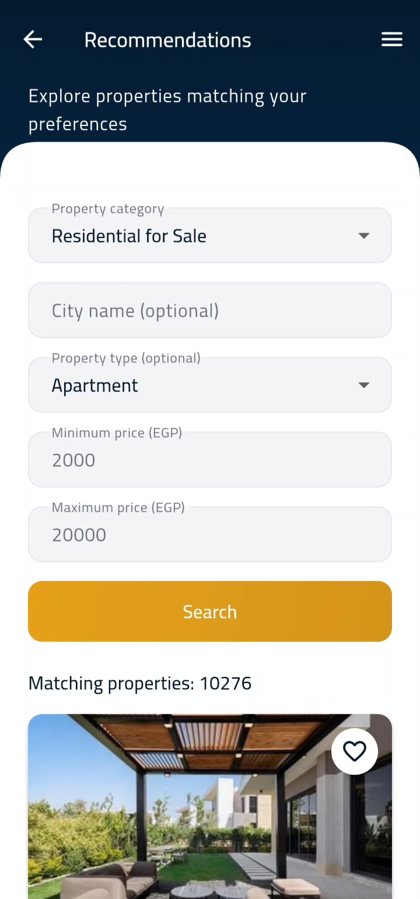
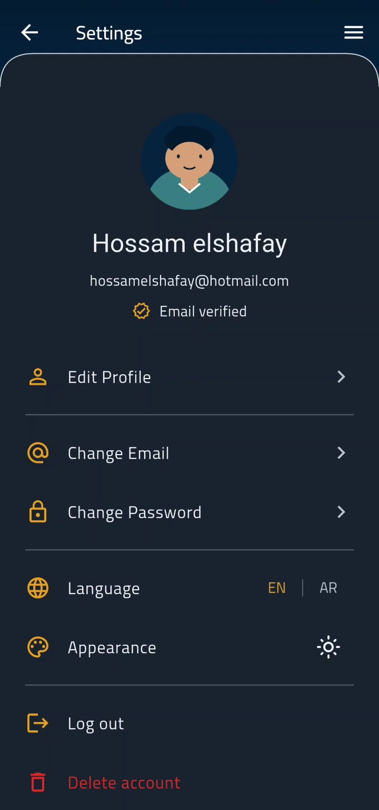

# EGY DEVELOPMENT

**Egyptian Real Estate Discovery, Price Valuation, and AI Advisory Platform**

EGY DEVELOPMENT is a full-stack real estate application built with Flutter (Android and Web), Firebase (Authentication and Cloud Firestore), and a FastAPI AI backend. It unifies categorized property browsing, hybrid recommendations, machine-learning price prediction, and a conversational AI assistant in a bilingual (English/Arabic) interface with Light and Dark themes.

---

## Main Features

- **Bilingual & Theme-Aware UI**: English (LTR) and Arabic (RTL) localization with Light and Dark appearance modes and a circular-reveal theme transition.
- **Custom Motion & Loading UX**: Custom-painted Cairo skyline splash animation, gesture-driven vertical onboarding transitions, asymmetric auth-to-home shell morphing, and skeleton loading placeholders.
- **Property Discovery & Search**: Categorized property catalog (Residential/Commercial for Sale/Rent), stacked featured carousel, live backend search suggestions, and property details.
- **AI Recommendations**: Filtered property search, pagination, and similar-property discovery over 62,977 cleaned Egyptian real estate listings.
- **Price Prediction**: Market value estimation from 7 property features returning estimated EGP price, per-meter rate, and a ±8% heuristic range.
- **AI Chat Assistant**: Session-managed conversational property assistant powered by Gemini with encrypted local chat persistence (`flutter_secure_storage`).
- **Account & Profile Management**: Two-step sign-up with avatar selection, profile editing (Display Name + 6 vector avatars) synced to Firebase Auth and Cloud Firestore, email change/verification refresh, password updates, and verified account deletion.

---

## Technology Stack

| Layer | Technologies |
|---|---|
| **Client** | Flutter, Dart, `flutter_bloc` (`Cubit`), `go_router`, `get_it`, `dio`, `google_fonts`, `lottie`, `shared_preferences`, `flutter_secure_storage` |
| **Cloud & Auth** | Firebase Core, Firebase Authentication (Email/Password & Google Sign-In), Cloud Firestore, Firebase Admin SDK |
| **Backend API** | Python 3.13, FastAPI, Uvicorn, Pydantic Settings |
| **ML & AI** | scikit-learn (`StackingRegressor`), XGBoost, SciPy, NumPy, Pandas, PyArrow, Joblib, Google GenAI (`GeminiClient` / `gemini-3.5-flash-lite`) |

---

## Application Showcase — Videos

### 1. Splash Screen
Custom-painted Cairo skyline construction, Nile and sun motion, and smooth transition into onboarding.

https://github.com/user-attachments/assets/99311669-1872-43a2-ba84-9e1112386796

### 2. Onboarding
Gesture-driven vertical `PageView` transitions with continuous page interpolation and language selection.

https://github.com/user-attachments/assets/86ea76d0-bcda-4989-bf03-e47a73f2d86e

### 3. Authentication
Asymmetric curved header morphing, two-step registration with avatar selection, and Lottie completion transition into Home.

https://github.com/user-attachments/assets/4b613bc9-570f-421a-998b-5a549f7d350e

### 4. Home & Property Animations
Convex navy header, category flip transitions, stacked featured property carousel, and AI tool shortcuts.

https://github.com/user-attachments/assets/3b60ab54-ffe5-49e9-8efc-5d3a01c7870c

### 5. Search Experience
Expanding search overlay with debounced backend queries, skeleton placeholders, and direct navigation to property details.

https://github.com/user-attachments/assets/22cd26de-ed59-49be-8ea6-ca1142901302

### 6. AI Chatbot
Conversational property assistant with session management, typing indicators, and inline property recommendations.

https://github.com/user-attachments/assets/b53e056c-eb8c-414d-aa60-4ad8cfb7cd50

---

## Feature Gallery — Screenshots

<table>
  <tr>
    <td align="center" width="50%">
      <br />
      <sub><strong>1. AI Recommendations</strong> — Hybrid matches and similar listings.</sub>
    </td>
    <td align="center" width="50%">
      <br />
      <sub><strong>2. Price Prediction</strong> — EGP valuation and per-meter rate.</sub>
    </td>
  </tr>
  <tr>
    <td align="center" width="50%">
      <br />
      <sub><strong>3. Favorites</strong> — UID-scoped saved properties in Firestore.</sub>
    </td>
    <td align="center" width="50%">
      <br />
      <sub><strong>4. Navigation Drawer</strong> — Theme, language, and feature routes.</sub>
    </td>
  </tr>
  <tr>
    <td align="center" width="50%">
      <br />
      <sub><strong>5. Profile</strong> — Verified identity, display name, and avatar.</sub>
    </td>
    <td align="center" width="50%">
      <br />
      <sub><strong>6. Settings</strong> — Account security, theme, and language.</sub>
    </td>
  </tr>
</table>

---

## AI Features

- **Hybrid Recommendations**: `POST /api/recommendations/search`, `POST /api/recommendations/catalog/sample`, `GET /api/recommendations/{id}`, and `GET /api/recommendations/similar` backed by content-based and clustering artifacts (`cleaned_properties.parquet`, `feature_matrix.npz`, `top_indices.npy`, `top_scores.npy`).
- **Price Prediction**: `POST /api/predict` and `GET /api/predict/options` backed by a `StackingRegressor` (`final_price_prediction_model.joblib`) using `size`, `bedrooms`, `bathrooms`, `latitude`, `longitude`, `property_type`, and `category`.
- **AI Chat**: `POST /api/chat` backed by `GeminiClient` (`gemini-3.5-flash-lite`) when `CHAT_ENABLED=true` on the backend and `--dart-define=ENABLE_LIVE_CHAT=true` on the client, with TTL session management on the server and encrypted local history on device.

---

## Architecture

The Flutter app follows a **Feature-First MVVM + Cubit + Repository** structure inspired by [hossamelshafay/ConnectHub](https://github.com/hossamelshafay/ConnectHub):

- `lib/features/<feature>/` — Feature modules (`splash`, `onboarding`, `authentication`, `home`, `properties`, `recommendations`, `price_prediction`, `ai_chat`, `favorites`, `profile`), each split into `data/`, `domain/`, and `presentation/` (`pages/`, `widgets/`, `cubit/`).
- `lib/core/` — Shared `ApiClient` (Firebase ID-token injection and environment validation), `AuthenticatedScaffold`, curved clippers/dividers, and `SkeletonShimmer` loaders.
- `lib/app/` — `go_router` configuration, manual `get_it` DI (`injection.dart`), ARB localization, and `AppTheme` / `ThemeCubit`.
- `firestore.rules` — UID-scoped security rules (`request.auth != null && request.auth.uid == uid`) for `/users/{uid}` profiles and `/users/{uid}/favorites/{favoriteId}`.

---

## Installation & Configuration

### Prerequisites

- Flutter SDK (Dart SDK `^3.12.2`)
- Python 3.13+
- Firebase project (`real-estate-e1418`) and local Firebase Admin service-account JSON stored outside the repository (e.g., `%USERPROFILE%\firebase-secrets\egy-firebase-admin.json`)

### Flutter Dependencies

```powershell
flutter pub get
flutter gen-l10n
```

---

## Running Android & Web

### Android via USB (ADB Reverse)

```powershell
adb reverse tcp:8000 tcp:8000
flutter run --dart-define=API_BASE_URL=http://127.0.0.1:8000 --dart-define=ENABLE_LIVE_CHAT=true
```

### Android Profile Mode over Wi-Fi

Replace `<LAPTOP_LAN_IP>` with your machine's Wi-Fi IPv4 address:

```powershell
flutter run --profile `
  --dart-define=API_BASE_URL=http://<LAPTOP_LAN_IP>:8000 `
  --dart-define=ENABLE_LIVE_CHAT=true `
  --dart-define=API_DEBUG_LOGS=true
```

### Flutter Web (Chrome)

```powershell
flutter run -d chrome `
  --web-port=3000 `
  --dart-define=API_BASE_URL=http://127.0.0.1:8000 `
  --dart-define=ENABLE_LIVE_CHAT=true `
  --dart-define=API_DEBUG_LOGS=true
```

---

## Backend Setup

```powershell
cd EGY_DEVELOPMENT_ai
python -m venv .venv
.venv\Scripts\pip install -r requirements.txt
copy .env.example .env
```

Configure `GEMINI_API_KEY` in `EGY_DEVELOPMENT_ai/.env` and set `GOOGLE_APPLICATION_CREDENTIALS` to your local Firebase Admin JSON file, then start the server from the repository root:

```powershell
.\START_BACKEND.bat
```

Verify health at `http://127.0.0.1:8000/api/health`. FastAPI CORS is configured for `http://localhost:3000` and `http://127.0.0.1:3000`.

---

## Testing

### Flutter

```powershell
flutter analyze --no-pub
flutter test --no-pub --concurrency=1
```

### Backend

```powershell
cd EGY_DEVELOPMENT_ai
.venv\Scripts\python.exe -m unittest discover -s tests -v
```

---

## Known Limitations

- **GitHub Video Layout**: GitHub Markdown does not support reliable side-by-side layout inside HTML tables for auto-expanded `user-attachments` video players without breaking HTML block parsing, so the six MP4 demos are presented sequentially as native inline players.
- **Local HTTP Development**: The FastAPI backend runs over HTTP locally; production deployment requires an HTTPS reverse proxy and setting `API_BASE_URL` to an `https://` endpoint (Release builds enforce HTTPS).
- **Firestore Rules Deployment**: Updated `/users/{uid}` profile rules in `firestore.rules` must be deployed (`firebase deploy --only firestore:rules`) for live cloud profile sync.
