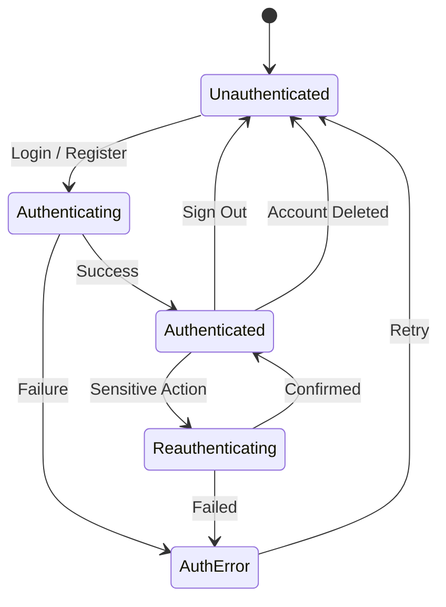
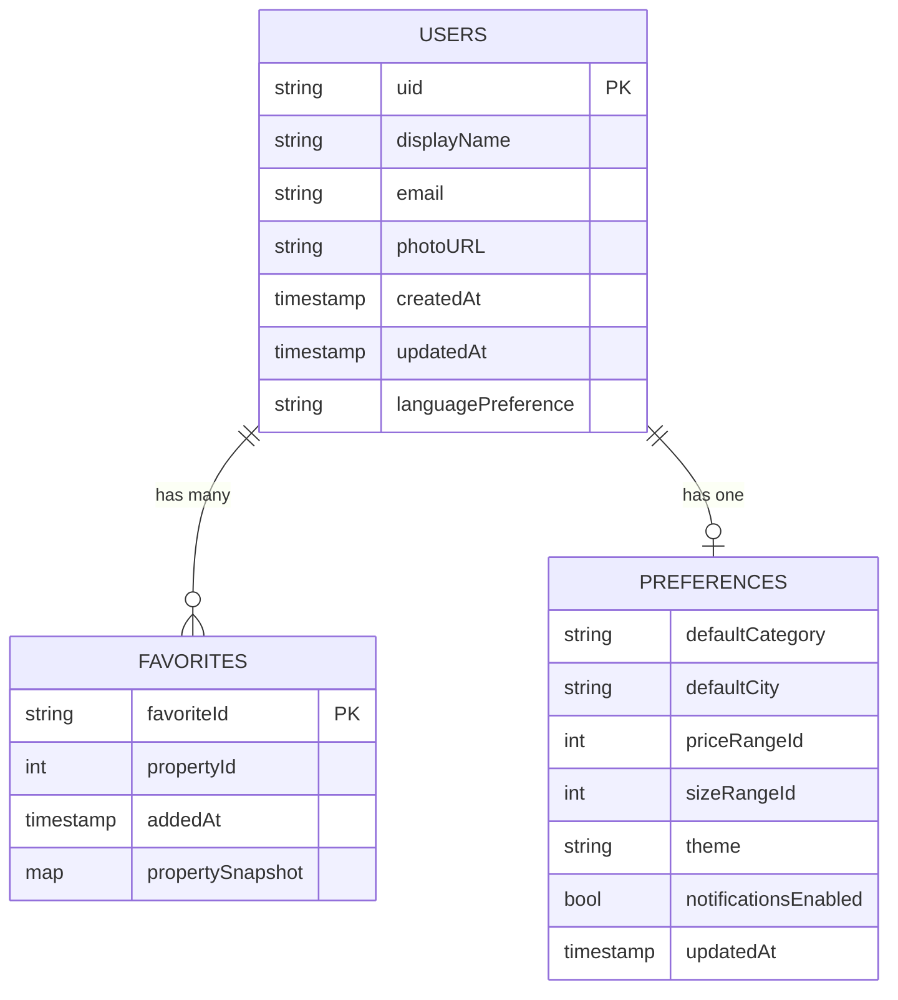
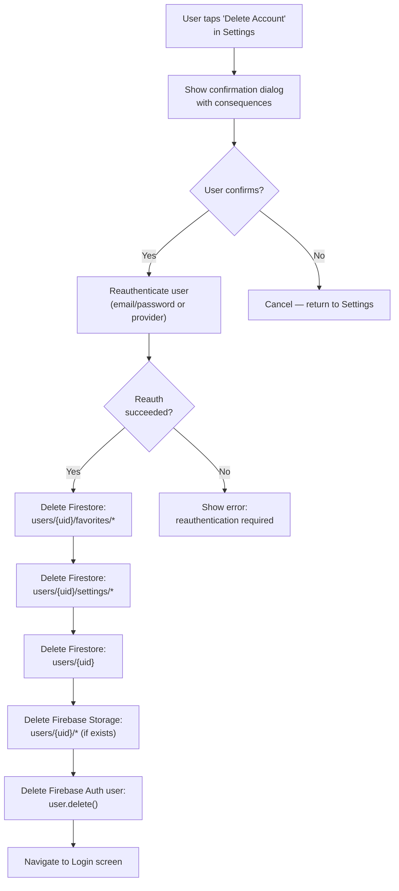

# Firebase Configuration & Strategy

> **EGY DEVELOPMENT** — Firebase Setup, Authentication, Firestore Schema & Security Rules

## Deployed Favorites rules

The default database in `real-estate-e1418` uses the scoped
`firestore.rules` at the repository root. The rule allows users to read,
create, and delete only their own favorites in `users/{uid}/favorites`.
The document ID is the canonical property ID, and the saved snapshot keeps
the backend property type and transaction category. Other paths and updates
remain denied. The schema and broader rules later on this page are historical
design guidance.

---

## Table of Contents

- [Current Status](#current-status)
- [Required Packages](#required-packages)
- [Firebase Initialization](#firebase-initialization)
- [Authentication Strategy](#authentication-strategy)
- [Firestore Schema Design](#firestore-schema-design)
- [Security Rules](#security-rules)
- [Index Requirements](#index-requirements)
- [Account Deletion](#account-deletion)
- [Migration Checklist](#migration-checklist)

---

## Current Status

| Component | Status | Details |
|---|---|---|
| Firebase Project | ✅ Configured | Project ID: `real-estate-e1418` |
| `firebase_options.dart` | ✅ Generated | Covers Android, iOS, macOS, Web, Windows |
| `google-services.json` | ✅ Present | Located at `android/app/google-services.json` |
| `firebase.json` | ✅ Present | FlutterFire config file |
| `firebase_core` | ✅ Installed | Version `^5.2.0` in `pubspec.yaml` |
| `Firebase.initializeApp()` | ❌ **Not called** | `main.dart` is still the default Flutter counter template |
| `firebase_auth` | ❌ **Not installed** | Not in `pubspec.yaml` |
| `cloud_firestore` | ❌ **Not installed** | Not in `pubspec.yaml` |
| `firebase_storage` | ❌ **Not installed** | Not in `pubspec.yaml` |
| Auth Providers | ⚠️ **Unknown** | Cannot verify until Firebase console is checked |

> [!WARNING]
> `main.dart` does **not** call `Firebase.initializeApp()` yet. This must be added before any Firebase service can be used.

---

## Required Packages

Add these to `pubspec.yaml`:

```yaml
dependencies:
  # Already installed
  firebase_core: ^5.2.0

  # Required — add these
  firebase_auth: ^5.5.1          # Authentication
  cloud_firestore: ^5.6.5        # User data, favorites, preferences

  # Optional — add if profile image upload is needed
  firebase_storage: ^12.4.4      # Profile photo storage
```

### Installation Commands

```bash
flutter pub add firebase_auth
flutter pub add cloud_firestore
# Optional:
flutter pub add firebase_storage
```

---

## Firebase Initialization

Update `main.dart` to initialize Firebase:

```dart
import 'package:firebase_core/firebase_core.dart';
import 'firebase_options.dart';

Future<void> main() async {
  WidgetsFlutterBinding.ensureInitialized();
  await Firebase.initializeApp(
    options: DefaultFirebaseOptions.currentPlatform,
  );
  runApp(const EgyApp());
}
```

> [!IMPORTANT]
> `WidgetsFlutterBinding.ensureInitialized()` must be called **before** `Firebase.initializeApp()`. This is required when calling async code before `runApp()`.

---

## Authentication Strategy

### Proposed Auth Providers

| Provider | Priority | Status | Notes |
|---|---|---|---|
| Email/Password | ✅ Required | `PROPOSED` | Core auth method — enable in Firebase Console |
| Google Sign-In | ✅ Required | `PROPOSED` | Popular in Egypt — requires `google_sign_in` package |
| Apple Sign-In | ✅ Required (iOS) | `PROPOSED` | **Mandatory** for App Store if other social logins are present |

> [!CAUTION]
> Before implementing any auth provider in Flutter code, you **must verify** it is enabled in the Firebase Console:
> Firebase Console → `real-estate-e1418` → Authentication → Sign-in method → Enable each provider.
> Code that references a disabled provider will throw runtime errors.

### Additional Packages for Social Auth

```yaml
dependencies:
  google_sign_in: ^6.3.0        # Google Sign-In
  sign_in_with_apple: ^6.1.4    # Apple Sign-In (iOS/macOS)
```

### Auth State Architecture



### Auth Cubit Pattern

```dart
// features/authentication/cubit/auth_cubit.dart

class AuthState {
  // States: initial, loading, authenticated, unauthenticated, error
}

class AuthCubit extends Cubit<AuthState> {
  final FirebaseAuth _auth;

  AuthCubit(this._auth) : super(AuthState.initial()) {
    // Listen to auth state changes
    _auth.authStateChanges().listen((user) {
      if (user != null) {
        emit(AuthState.authenticated(user));
      } else {
        emit(AuthState.unauthenticated());
      }
    });
  }

  Future<void> signInWithEmail(String email, String password) async { ... }
  Future<void> signUpWithEmail(String email, String password, String name) async { ... }
  Future<void> signInWithGoogle() async { ... }
  Future<void> signInWithApple() async { ... }
  Future<void> signOut() async { ... }
  Future<void> resetPassword(String email) async { ... }
  Future<void> deleteAccount() async { ... }
}
```

### Passing Auth Token to AI Backend

```dart
// core/network/auth_interceptor.dart

class AuthInterceptor extends Interceptor {
  final FirebaseAuth _auth;

  AuthInterceptor(this._auth);

  @override
  void onRequest(RequestOptions options, RequestInterceptorHandler handler) async {
    final user = _auth.currentUser;
    if (user != null) {
      final token = await user.getIdToken();
      options.headers['Authorization'] = 'Bearer $token';
    }
    handler.next(options);
  }
}
```

---

## Firestore Schema Design

### Collection: `users/{uid}`

Stores the user's profile data. Created on first sign-up.

```json
{
  "displayName": "Ahmed Mohamed",
  "email": "ahmed@example.com",
  "photoURL": "https://firebasestorage.googleapis.com/.../profile.jpg",
  "createdAt": "2024-01-15T10:30:00Z",
  "updatedAt": "2024-06-20T14:15:00Z",
  "languagePreference": "ar"
}
```

| Field | Type | Required | Description |
|---|---|---|---|
| `displayName` | `string` | ✅ | User's display name |
| `email` | `string` | ✅ | User's email (from Firebase Auth) |
| `photoURL` | `string?` | ❌ | Profile photo URL (Firebase Storage or provider) |
| `createdAt` | `timestamp` | ✅ | Account creation time |
| `updatedAt` | `timestamp` | ✅ | Last profile update time |
| `languagePreference` | `string` | ❌ | `"ar"` or `"en"` (default: `"ar"`) |

### Subcollection: `users/{uid}/favorites/{favoriteId}`

Stores the user's favorited properties. Uses denormalized property snapshot for offline display.

```json
{
  "propertyId": 12345,
  "addedAt": "2024-06-15T08:30:00Z",
  "propertySnapshot": {
    "title": "شقة للبيع في التجمع الخامس",
    "price": 1500000,
    "size": 120,
    "bedrooms": 3,
    "bathrooms": 2,
    "city": "cairo",
    "imageUrl": "https://...",
    "category": "sale",
    "propertyType": "apartment"
  }
}
```

| Field | Type | Required | Description |
|---|---|---|---|
| `propertyId` | `int` | ✅ | Backend property ID |
| `addedAt` | `timestamp` | ✅ | When the user favorited it |
| `propertySnapshot` | `map` | ✅ | Denormalized property data for offline/fast display |

> [!TIP]
> **Why denormalize?** The property data lives on the Python backend, not Firestore. Storing a snapshot avoids an API call just to show the favorites list. When the user taps a favorite, fetch fresh data from `GET /api/recommendations/{property_id}`.

### Document: `users/{uid}/preferences` (single document, not a subcollection)

Alternatively, store preferences as a subcollection document at `users/{uid}/settings/preferences`:

```json
{
  "defaultCategory": "sale",
  "defaultCity": "cairo",
  "priceRangeId": 3,
  "sizeRangeId": 2,
  "theme": "light",
  "notificationsEnabled": true,
  "updatedAt": "2024-06-20T14:15:00Z"
}
```

| Field | Type | Required | Description |
|---|---|---|---|
| `defaultCategory` | `string?` | ❌ | Preferred property category |
| `defaultCity` | `string?` | ❌ | Preferred city |
| `priceRangeId` | `int?` | ❌ | Preferred price range |
| `sizeRangeId` | `int?` | ❌ | Preferred size range |
| `theme` | `string` | ❌ | `"light"` or `"dark"` |
| `notificationsEnabled` | `bool` | ❌ | Push notification preference |
| `updatedAt` | `timestamp` | ✅ | Last preferences update |

### Schema Diagram



---

## Security Rules

### Firestore Rules

```javascript
rules_version = '2';

service cloud.firestore {
  match /databases/{database}/documents {

    // Default: deny all
    match /{document=**} {
      allow read, write: if false;
    }

    // Users collection
    match /users/{uid} {
      // User can only read and write their own document
      allow read: if request.auth != null && request.auth.uid == uid;
      allow create: if request.auth != null && request.auth.uid == uid
                    && request.resource.data.keys().hasAll(['displayName', 'email', 'createdAt', 'updatedAt'])
                    && request.resource.data.displayName is string
                    && request.resource.data.email is string;
      allow update: if request.auth != null && request.auth.uid == uid
                    && request.resource.data.diff(resource.data).affectedKeys()
                       .hasOnly(['displayName', 'photoURL', 'languagePreference', 'updatedAt']);

      // Favorites subcollection
      match /favorites/{favoriteId} {
        allow read: if request.auth != null && request.auth.uid == uid;
        allow create: if request.auth != null && request.auth.uid == uid
                      && request.resource.data.keys().hasAll(['propertyId', 'addedAt', 'propertySnapshot'])
                      && request.resource.data.propertyId is int;
        allow delete: if request.auth != null && request.auth.uid == uid;
        // No update — delete and re-add instead
        allow update: if false;
      }

      // Preferences document
      match /settings/preferences {
        allow read: if request.auth != null && request.auth.uid == uid;
        allow write: if request.auth != null && request.auth.uid == uid;
      }
    }
  }
}
```

> [!IMPORTANT]
> **Key security principles:**
> 1. Users can **only** read and write their **own** data (`request.auth.uid == uid`)
> 2. The `email` field on the user document cannot be changed via Firestore (change via Firebase Auth)
> 3. Favorites cannot be updated — only created or deleted
> 4. No document is publicly readable
> 5. Default deny-all rule catches any unmatched paths

---

## Index Requirements

### Composite Indexes (create in Firebase Console or `firestore.indexes.json`)

| Collection | Fields | Query |
|---|---|---|
| `users/{uid}/favorites` | `addedAt` DESC | Favorites sorted by most recent |

> [!NOTE]
> Since favorites are scoped to a single user's subcollection (small dataset), most queries won't need composite indexes. Firestore automatically indexes each field individually. Add composite indexes only if the console warns about missing indexes during development.

### `firestore.indexes.json`

```json
{
  "indexes": [
    {
      "collectionGroup": "favorites",
      "queryScope": "COLLECTION",
      "fields": [
        { "fieldPath": "addedAt", "order": "DESCENDING" }
      ]
    }
  ],
  "fieldOverrides": []
}
```

---

## Account Deletion

Account deletion must comply with Apple App Store and Google Play requirements. It must fully remove all user data.

### Deletion Flow



### Implementation

```dart
Future<void> deleteAccount() async {
  final user = FirebaseAuth.instance.currentUser;
  if (user == null) return;

  final uid = user.uid;
  final firestore = FirebaseFirestore.instance;

  // 1. Delete favorites subcollection
  final favorites = await firestore
      .collection('users')
      .doc(uid)
      .collection('favorites')
      .get();
  for (final doc in favorites.docs) {
    await doc.reference.delete();
  }

  // 2. Delete preferences
  await firestore
      .collection('users')
      .doc(uid)
      .collection('settings')
      .doc('preferences')
      .delete();

  // 3. Delete user document
  await firestore.collection('users').doc(uid).delete();

  // 4. Delete storage files (if applicable)
  // await FirebaseStorage.instance.ref('users/$uid').listAll()...delete

  // 5. Delete Firebase Auth user (must be last)
  await user.delete();
}
```

> [!CAUTION]
> `user.delete()` requires **recent authentication**. If the user signed in more than ~5 minutes ago, Firebase will throw `requires-recent-login`. Always reauthenticate before deletion. See [SECURITY.md](./SECURITY.md) for reauthentication details.

---

## Migration Checklist

Use this checklist when setting up Firebase for the first time:

- [ ] Verify Firebase project `real-estate-e1418` in Firebase Console
- [ ] Enable **Email/Password** auth provider in Console
- [ ] Enable **Google Sign-In** auth provider in Console
- [ ] Enable **Apple Sign-In** auth provider in Console (configure with Apple Developer account)
- [ ] Run `flutter pub add firebase_auth cloud_firestore`
- [ ] Update `main.dart` to call `Firebase.initializeApp()`
- [ ] Create Firestore database (choose region: `europe-west1` or `us-central1`)
- [ ] Deploy Firestore security rules
- [ ] Deploy Firestore indexes
- [ ] Add `google_sign_in` package and configure SHA-1 fingerprint
- [ ] Add `sign_in_with_apple` package and configure Apple Developer settings
- [ ] (Optional) Enable Firebase Storage for profile photos
- [ ] Test auth flow on Android emulator
- [ ] Test auth flow on iOS simulator
- [ ] Verify security rules in Firebase Console Rules Playground

---

> **Next:** See [SECURITY.md](./SECURITY.md) for the complete security threat model and mitigation plan.
