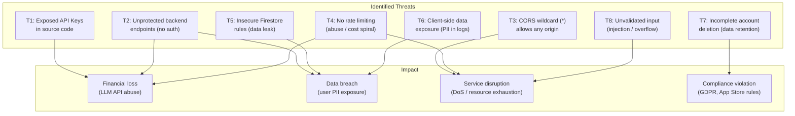
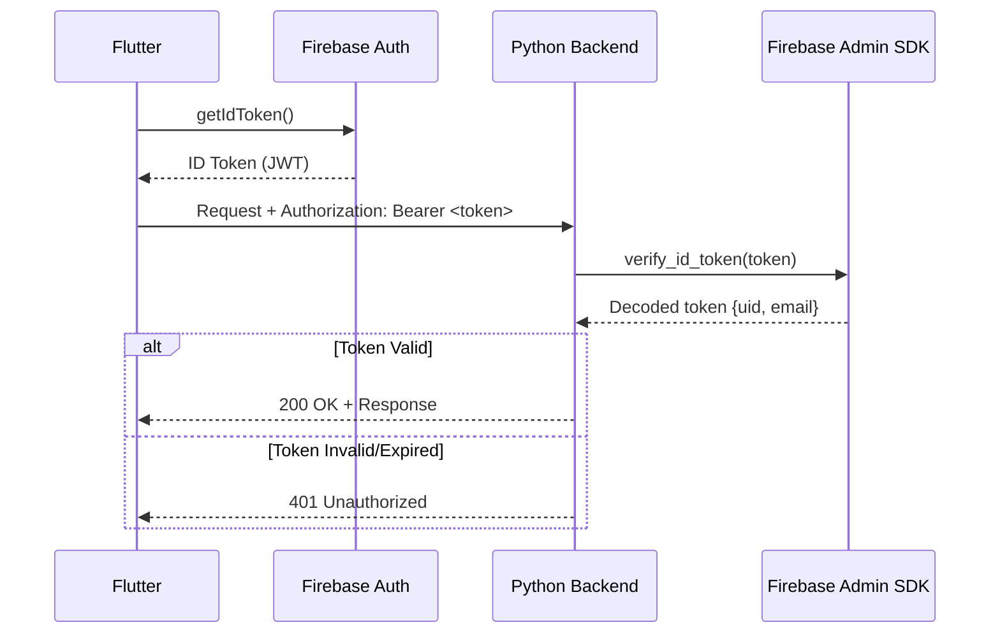
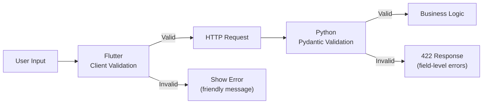

# Security Plan

> **EGY DEVELOPMENT** — Threat Model, Credential Management & Risk Mitigation

---

## Table of Contents

- [Threat Model Overview](#threat-model-overview)
- [Risk Mitigation Matrix](#risk-mitigation-matrix)
- [1. Credential Management](#1-credential-management)
- [2. API Security](#2-api-security)
- [3. Firebase Security](#3-firebase-security)
- [4. Client-Side Security](#4-client-side-security)
- [5. Data Protection](#5-data-protection)
- [6. Account Deletion Security](#6-account-deletion-security)
- [7. Rate Limiting](#7-rate-limiting)
- [8. Input Validation](#8-input-validation)
- [Security Checklist](#security-checklist)

---

## Threat Model Overview



---

## Risk Mitigation Matrix

| ID | Threat | Severity | Likelihood | Current Status | Mitigation | Priority |
|---|---|---|---|---|---|---|
| T1 | Exposed API keys in source code | 🔴 Critical | High | ⚠️ **At risk** — no `.env` strategy yet | Use `.env` files + `--dart-define` for Flutter | **P0** |
| T2 | Unprotected backend endpoints | 🔴 Critical | Certain | ❌ **No auth** on any endpoint | Add Firebase ID token verification | **P0** |
| T3 | CORS wildcard (`*`) | 🟡 Medium | High | ❌ CORS set to `*` | Restrict to app domain in production | **P1** |
| T4 | No rate limiting | 🟡 Medium | High | ❌ No limits exist | Implement per-user and per-IP rate limits | **P1** |
| T5 | Insecure Firestore rules | 🔴 Critical | Certain | ❌ **No rules deployed** (no Firestore yet) | Deploy ownership-enforcing rules before launch | **P0** |
| T6 | PII in logs / local storage | 🟡 Medium | Medium | ⚠️ Unknown | Audit logging, avoid storing PII locally | **P1** |
| T7 | Incomplete account deletion | 🟡 Medium | Low | ❌ Not implemented | Full cascade delete with reauthentication | **P1** |
| T8 | Unvalidated input | 🟡 Medium | Medium | ✅ Partial (Pydantic on backend) | Add client-side validation, sanitize inputs | **P2** |

---

## 1. Credential Management

### Never Hardcode Secrets

> [!CAUTION]
> **Never** commit API keys, Firebase credentials, or secrets to version control. This is the single most common security mistake.

### Python Backend (`.env`)

Store secrets in a `.env` file at the project root, **excluded from git**:

```bash
# EGY_DEVELOPMENT_ai/.env
GEMINI_API_KEY=your-gemini-api-key-here
GEMINI_MODEL=gemini-2.0-flash
# OR
GROQ_API_KEY=your-groq-api-key-here
LLM_MODEL=llama-3.3-70b-versatile
LLM_PROVIDER=groq
```

**`.gitignore` must include:**
```
.env
.env.local
.env.production
```

### Flutter App (`--dart-define`)

Pass configuration values at build time, never in source code:

```bash
# Development
flutter run --dart-define=API_BASE_URL=http://localhost:8000

# Production
flutter run --release \
  --dart-define=API_BASE_URL=https://api.egydevelopment.com
```

Access in Dart:

```dart
class AppConfig {
  static const apiBaseUrl = String.fromEnvironment(
    'API_BASE_URL',
    defaultValue: 'http://localhost:8000',
  );
}
```

> [!IMPORTANT]
> `firebase_options.dart` contains Firebase project configuration (API keys, project IDs). These are **not** secret — they are designed to be embedded in the client app. Firebase security comes from **Security Rules** and **Auth**, not from hiding these keys.

### Secret Rotation Plan

| Secret | Rotation Frequency | Procedure |
|---|---|---|
| `GEMINI_API_KEY` | Quarterly or on exposure | Generate new key in Google AI Studio, update deployment env |
| `GROQ_API_KEY` | Quarterly or on exposure | Generate new key in Groq Console, update deployment env |
| Firebase service account key | Only if compromised | Regenerate in Firebase Console → Service Accounts |

---

## 2. API Security

### Current State: ❌ No Authentication

All backend endpoints are publicly accessible. Anyone with the URL can:
- Send unlimited chat messages (consuming LLM API quota)
- Run unlimited price predictions
- Access all 62,977 property listings
- Exhaust server resources

### Proposed: Firebase ID Token Verification



### Python Backend Implementation

```python
# middleware/auth.py
from firebase_admin import auth, credentials, initialize_app

cred = credentials.Certificate("service-account-key.json")
initialize_app(cred)

async def verify_firebase_token(authorization: str = Header(None)):
    if not authorization or not authorization.startswith("Bearer "):
        raise HTTPException(401, "Missing or invalid Authorization header")

    token = authorization.split("Bearer ")[1]
    try:
        decoded = auth.verify_id_token(token)
        return decoded  # Contains uid, email, etc.
    except auth.InvalidIdTokenError:
        raise HTTPException(401, "Invalid Firebase ID token")
    except auth.ExpiredIdTokenError:
        raise HTTPException(401, "Expired Firebase ID token")
```

### CORS Configuration

**Current:** `allow_origins=["*"]` — allows any website to call the API.

**Production fix:**

```python
app.add_middleware(
    CORSMiddleware,
    allow_origins=[
        "https://egydevelopment.com",
        "https://app.egydevelopment.com",
        # Remove "*" in production
    ],
    allow_credentials=True,
    allow_methods=["GET", "POST"],
    allow_headers=["Authorization", "Content-Type"],
)
```

> [!WARNING]
> CORS `*` in production means any malicious website can make API calls using your users' browsers. This must be restricted before deployment.

---

## 3. Firebase Security

### Firestore Security Rules

See [FIREBASE.md](./FIREBASE.md) for the complete rules. Key principles:

| Principle | Implementation |
|---|---|
| **Ownership enforcement** | `request.auth.uid == uid` on every rule |
| **Default deny** | Top-level `allow read, write: if false` |
| **Field validation** | Required fields checked on `create` |
| **Immutable fields** | `email` and `createdAt` cannot be updated via Firestore |
| **No public data** | All collections require authentication |

### Testing Security Rules

Use the Firebase Emulator Suite or the Console's Rules Playground:

```bash
# Install Firebase Emulator
firebase emulators:start --only firestore

# Run rules tests
firebase emulators:exec "npm test" --only firestore
```

### Firebase Auth Security

| Setting | Recommendation |
|---|---|
| Email enumeration protection | ✅ Enable in Console (prevents "email already exists" leaks) |
| Password requirements | Minimum 8 characters (Firebase default is 6 — consider custom validation) |
| Email verification | ✅ Require before allowing sensitive operations |
| Multi-factor auth | 🔮 Consider for future (not needed for MVP) |

---

## 4. Client-Side Security

### No Passwords Stored Locally

| Data | Storage | Secure? |
|---|---|---|
| Firebase ID Token | Managed by Firebase SDK (secure storage) | ✅ |
| User credentials | **Never** stored by the app | ✅ |
| Chat session ID | In-memory only (random UUID) | ✅ |
| Favorites | Firestore (synced, not local) | ✅ |
| Preferences | Firestore or SharedPreferences (non-sensitive) | ✅ |

### No PII in Logs

```dart
// ❌ NEVER do this
log('User logged in: $email, password: $password');
log('Token: $idToken');

// ✅ Do this instead
log('User logged in: uid=${user.uid}');
log('API request to /api/chat (session: ${sessionId.substring(0, 8)}...)');
```

> [!CAUTION]
> In production builds, disable all debug logging. Use `kReleaseMode` to gate log output:
> ```dart
> if (!kReleaseMode) {
>   debugPrint('Debug info...');
> }
> ```

### Secure Network Configuration

For Android, ensure `network_security_config.xml` does not allow cleartext traffic in release:

```xml
<!-- android/app/src/main/res/xml/network_security_config.xml -->
<network-security-config>
    <base-config cleartextTrafficPermitted="false">
        <trust-anchors>
            <certificates src="system" />
        </trust-anchors>
    </base-config>
    <!-- Allow cleartext for local dev only -->
    <domain-config cleartextTrafficPermitted="true">
        <domain includeSubdomains="true">10.0.2.2</domain>
        <domain includeSubdomains="true">localhost</domain>
    </domain-config>
</network-security-config>
```

---

## 5. Data Protection

### Data Classification

| Data Type | Classification | Storage | Protection |
|---|---|---|---|
| User email | PII | Firebase Auth + Firestore | Auth-gated, ownership rules |
| User display name | PII | Firestore | Auth-gated, ownership rules |
| Profile photo | PII | Firebase Storage | Auth-gated path rules |
| Favorite properties | User data | Firestore | Ownership-scoped subcollection |
| Chat messages | Transient | In-memory (backend) | 30-min TTL, no persistence |
| Property listings | Public data | Python backend (parquet) | No PII, read-only dataset |
| AI predictions | Computed | Not stored | Returned per-request, not persisted |

### Data Minimization

- Collect only what is needed: name, email, photo (optional), language preference
- Chat messages are not persisted — lost on session expiry (30 min) or backend restart
- Property data is a static, anonymous dataset with no user PII
- No analytics tracking without explicit user consent

---

## 6. Account Deletion Security

### Requirements

| Requirement | Source | Implementation |
|---|---|---|
| Must offer account deletion | Apple App Store, Google Play | Settings → Delete Account |
| Must delete all user data | GDPR, App Store Guidelines | Cascade delete Firestore + Storage + Auth |
| Must reauthenticate before deletion | Security best practice | Prompt for password or provider re-sign-in |

### Reauthentication Before Deletion

```dart
Future<void> reauthenticateAndDelete(String password) async {
  final user = FirebaseAuth.instance.currentUser;
  if (user == null) return;

  // Reauthenticate
  final credential = EmailAuthProvider.credential(
    email: user.email!,
    password: password,
  );

  try {
    await user.reauthenticateWithCredential(credential);
  } on FirebaseAuthException catch (e) {
    if (e.code == 'wrong-password') {
      throw Exception('Incorrect password. Please try again.');
    }
    rethrow;
  }

  // Proceed with deletion (see FIREBASE.md for full flow)
  await _cascadeDeleteUserData(user.uid);
  await user.delete();
}
```

### For Social Auth Providers

```dart
Future<void> reauthenticateWithGoogle() async {
  final googleUser = await GoogleSignIn().signIn();
  if (googleUser == null) return;

  final googleAuth = await googleUser.authentication;
  final credential = GoogleAuthProvider.credential(
    accessToken: googleAuth.accessToken,
    idToken: googleAuth.idToken,
  );

  await FirebaseAuth.instance.currentUser!
      .reauthenticateWithCredential(credential);
}
```

> [!IMPORTANT]
> After `user.delete()`, the user is immediately signed out. Navigate to the login screen and clear any local caches.

---

## 7. Rate Limiting

### Client-Side Throttling

Prevent accidental rapid-fire requests from the Flutter app:

```dart
class ThrottledApiClient {
  final Map<String, DateTime> _lastRequest = {};

  bool canRequest(String endpoint, Duration cooldown) {
    final last = _lastRequest[endpoint];
    if (last != null && DateTime.now().difference(last) < cooldown) {
      return false;
    }
    _lastRequest[endpoint] = DateTime.now();
    return true;
  }
}
```

### Recommended Limits

| Endpoint | Per-User Limit | Per-IP Limit | Cooldown |
|---|---|---|---|
| `POST /api/chat` | 20/min | 10/min | 2s between messages |
| `POST /api/predict` | 30/min | 15/min | 1s between requests |
| `GET/POST /api/recommendations/*` | 60/min | 30/min | 500ms |
| `GET /api/health` | Unlimited | 60/min | None |

### Server-Side Implementation (`PROPOSED`)

```python
# Using slowapi or custom middleware
from slowapi import Limiter
from slowapi.util import get_remote_address

limiter = Limiter(key_func=get_remote_address)

@app.post("/api/chat")
@limiter.limit("20/minute")
async def chat(request: Request, body: ChatRequest):
    ...
```

---

## 8. Input Validation

### Defense in Depth: Validate on Both Sides



### Client-Side Validation Rules

```dart
class Validators {
  static String? chatMessage(String? value) {
    if (value == null || value.trim().isEmpty) {
      return 'Message cannot be empty';
    }
    if (value.length > 4000) {
      return 'Message too long (max 4000 characters)';
    }
    return null;
  }

  static String? propertySize(String? value) {
    final size = double.tryParse(value ?? '');
    if (size == null || size <= 0) {
      return 'Enter a valid size';
    }
    if (size > 10000) {
      return 'Size seems unrealistic';
    }
    return null;
  }

  static String? email(String? value) {
    if (value == null || value.trim().isEmpty) {
      return 'Email is required';
    }
    if (!RegExp(r'^[\w-\.]+@([\w-]+\.)+[\w-]{2,4}$').hasMatch(value)) {
      return 'Enter a valid email address';
    }
    return null;
  }

  static String? password(String? value) {
    if (value == null || value.length < 8) {
      return 'Password must be at least 8 characters';
    }
    return null;
  }
}
```

### Server-Side (Already in Place)

The Python backend uses **Pydantic models** for automatic type checking and validation. Invalid requests return structured `422` errors. No additional server-side work is needed for basic validation.

### SQL / NoSQL Injection

- **Firestore**: Not vulnerable to SQL injection (document-based, SDK-parameterized)
- **Python backend**: Uses pandas/parquet files, not SQL databases — no SQL injection risk
- **LLM prompt injection**: The chatbot uses a fixed system prompt with grounding checks. User input is passed as the user message, not injected into the system prompt. Tool outputs are verified for numerical accuracy.

---

## Security Checklist

### Before Development

- [ ] Add `.env` to `.gitignore` (Python backend)
- [ ] Never commit API keys to version control
- [ ] Set up `--dart-define` for Flutter build configuration
- [ ] Enable email enumeration protection in Firebase Console

### Before Staging / Testing

- [ ] Deploy Firestore security rules
- [ ] Test security rules in Firebase Emulator
- [ ] Verify auth providers are enabled in Firebase Console
- [ ] Implement Firebase ID token verification on Python backend
- [ ] Add client-side input validation for all forms
- [ ] Add auth interceptor to HTTP client

### Before Production

- [ ] Restrict CORS to specific domains (remove `*`)
- [ ] Implement server-side rate limiting
- [ ] Disable debug logging in release builds
- [ ] Configure Android network security (no cleartext in release)
- [ ] Verify account deletion cascade works completely
- [ ] Test reauthentication flow for all providers
- [ ] Rotate all API keys to production values
- [ ] Enable Firebase App Check (optional, anti-abuse)
- [ ] Review Firestore rules one final time
- [ ] Ensure no PII appears in any log output
- [ ] Set up monitoring/alerting for unusual API usage

---

> **Related docs:**
> - [AI_INTEGRATION.md](./AI_INTEGRATION.md) — AI backend architecture and deployment
> - [API_CONTRACTS.md](./API_CONTRACTS.md) — Full endpoint schemas and Dart models
> - [FIREBASE.md](./FIREBASE.md) — Firebase setup and Firestore schema
